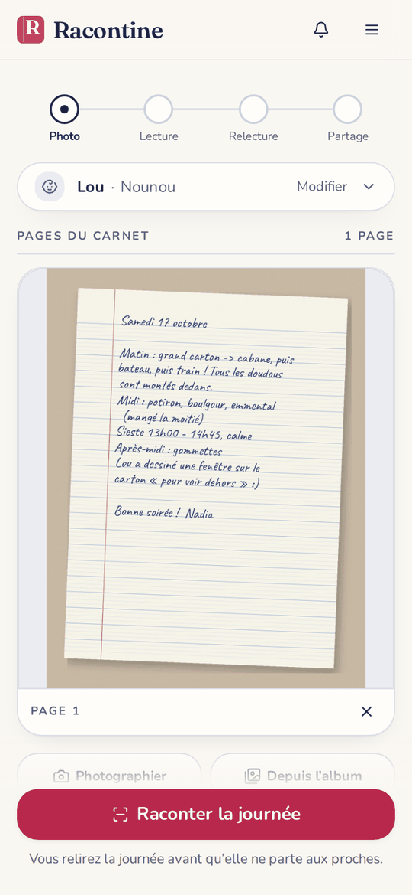
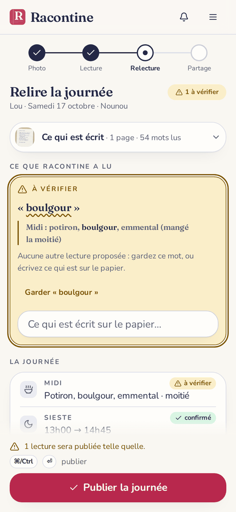
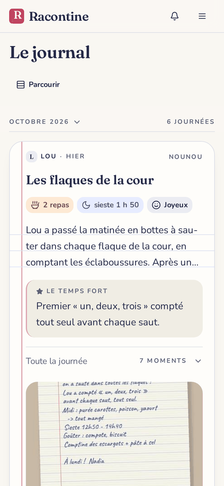
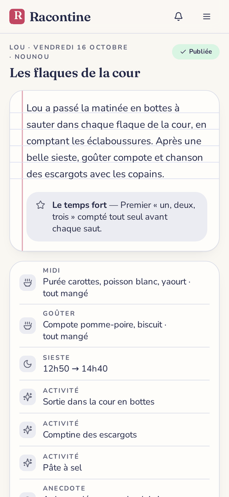
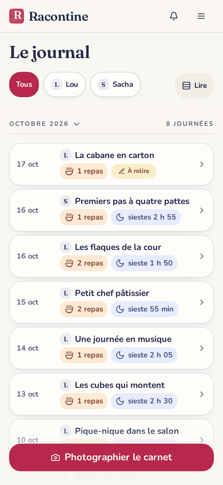
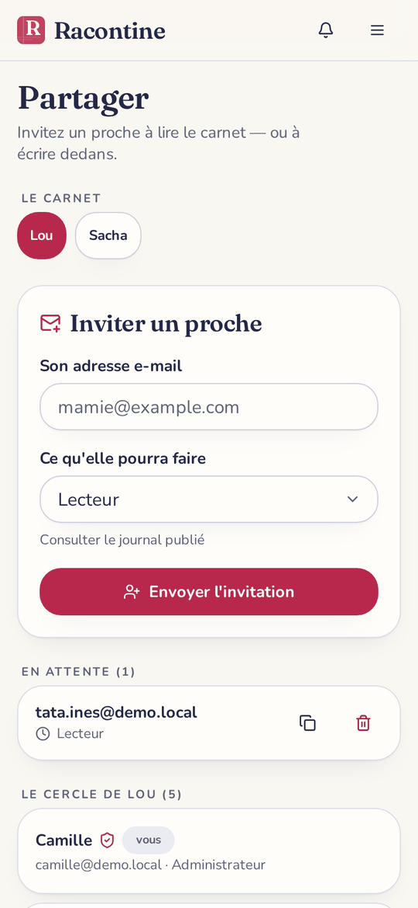

<h1 align="center">Racontine</h1>

  Votre carnet de liaison, dématérialisé sans rien demander à la nounou.

  

  Le soir, vous photographiez la page du carnet. 
  Racontine la lit et en fait une petite histoire que vos proches peuvent lire.

  <a href="https://racontine.battistella.ovh/">Essayer Racontine</a>

---

## Une photo, et c'est tout

  

La nounou, la MAM ou la crèche continuent d'écrire dans leur cahier comme d'habitude.
Vous prenez la page en photo, même un peu de travers. S'il y a plusieurs pages, vous les ajoutez toutes.

## Vous gardez le dernier mot

  

Racontine vous montre ce qu'elle a compris : les repas, la sieste, les activités, le petit mot de la fin.
Quand une écriture lui résiste, elle vous le dit. Vous corrigez d'un geste, puis vous publiez.

## Le journal de votre enfant

  

Chaque journée devient une carte avec un titre, un récit et le temps fort du jour.
La photo de la page reste là, avec son écriture, comme dans le carnet.

## Toute la journée, en un coup d'œil

  

Ce qu'il a mangé, combien de temps il a dormi, ce qui l'a fait rire.
Les grands-parents savent enfin quoi demander au téléphone.

## Une année entière, sans se perdre

  

Passez en vue compacte pour remonter les semaines, ou sautez directement à un mois.
Avec plusieurs enfants, chacun a son carnet.

## Vous choisissez qui lit

  

Invitez un proche par e-mail. Il se connecte sans mot de passe et peut être prévenu à chaque nouvelle journée.
Un grand-parent lit, un co-parent peut aussi publier, et vous pouvez retirer quelqu'un quand vous voulez.

## Chez vous, à vous

Racontine peut tourner sur votre propre serveur, gratuitement et sans limite.
Vous pouvez aussi utiliser la version hébergée, avec 14 jours d'essai sans carte bancaire.
Dans les deux cas, vous pouvez télécharger tout votre journal ou l'effacer à tout moment.

---

  <a href="docs/installation.md">Installer / contribuer</a>

  
    Conçu et hébergé en France par <a href="https://pro.battistella.ovh/">BATTISTELLA</a> ·
    <a href="https://pro.battistella.ovh/mentions-legales">Mentions légales</a> ·
    <a href="https://pro.battistella.ovh/cgv">Conditions de vente</a> ·
    <a href="https://pro.battistella.ovh/remboursement">Résiliation & remboursement</a> ·
    <a href="https://pro.battistella.ovh/confidentialite">Confidentialité</a>
  

